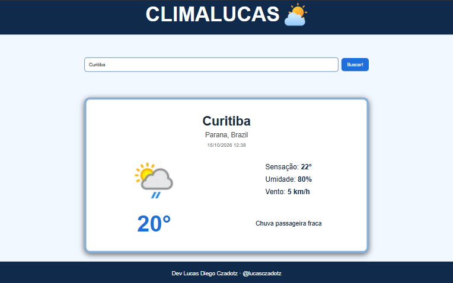

# ClimaLucas

Aplicação web que mostra o clima atual de qualquer cidade, usando a WeatherAPI.



## Tecnologias

- HTML5
- CSS3 (Grid, Flexbox e design responsivo)
- JavaScript (fetch com async/await)
- [WeatherAPI](https://www.weatherapi.com/)

## Funcionalidades

- Busca do clima atual por nome de cidade
- Temperatura, sensação térmica, umidade e vento
- Estado e país da cidade encontrada
- Mensagens de erro para cidade inexistente e falta de conexão
- Layout responsivo (celular e computador)

## Como rodar

1. Clone o repositório:
```
   git clone https://github.com/LucasCzadotz/weather-app.git
```
2. Crie uma conta gratuita em [weatherapi.com](https://www.weatherapi.com/) e copie sua chave de API.
3. Na pasta `js`, copie o arquivo `config.example.js` e renomeie a cópia para `config.js`.
4. Abra o `config.js` e troque o texto pela sua chave:
```js
   const CHAVE = "sua_chave_aqui";
```
5. Abra o `index.html` no navegador.

